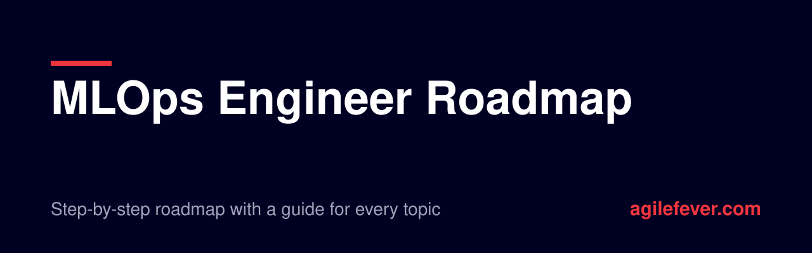

# MLOps Engineer Roadmap

> A step-by-step roadmap to become an MLOps Engineer, from Git and Docker to MLflow, Airflow, Kubernetes, LLMOps and Agentic AI Ops, with a blog for every topic

## Table of Contents

- [Who is an MLOps Engineer?](#who-is-an-mlops-engineer)
- [How to Use This Roadmap](#how-to-use-this-roadmap)
- [Step 0: Must Know](#step-0-must-know)
- [Step 1: Python and Data Libraries](#step-1-python-and-data-libraries)
- [Step 2: Statistics and Machine Learning You Will Operationalize](#step-2-statistics-and-machine-learning-you-will-operationalize)
- [Step 3: Serving a Model as an App](#step-3-serving-a-model-as-an-app)
- [Step 4: Version Control with Git](#step-4-version-control-with-git)
- [Step 5: CI/CD with GitHub Actions](#step-5-cicd-with-github-actions)
- [Step 6: Experiment Tracking with MLflow](#step-6-experiment-tracking-with-mlflow)
- [Step 7: Data Versioning with DVC and DagsHub](#step-7-data-versioning-with-dvc-and-dagshub)
- [Step 8: Docker and Apache Airflow](#step-8-docker-and-apache-airflow)
- [Step 9: Kubernetes and Monitoring](#step-9-kubernetes-and-monitoring)
- [Step 10: MLOps on AWS, Azure and Google Cloud](#step-10-mlops-on-aws-azure-and-google-cloud)
- [Step 11: LLMOps](#step-11-llmops)
- [Step 12: Agentic AI Ops](#step-12-agentic-ai-ops)
- [Step 13: Career, Certification and Interview Preparation](#step-13-career-certification-and-interview-preparation)
- [Learn This Roadmap with a Mentor](#learn-this-roadmap-with-a-mentor)
- [License](#license)

### Prepared and maintained by [AgileFever](https://agilefever.com)

### Follow AgileFever

- [LinkedIn](https://www.linkedin.com/company/agilefever/)
- [YouTube](https://www.youtube.com/@AgileFever)
- [X/Twitter](https://x.com/agilefever)
- [Website](https://agilefever.com)

## Learn with AgileFever

- [MLOps, LLMOps and Agentic AI Ops BootCamp](https://agilefever.com/bootcamps/mlops-bootcamp/)

---

> **Note: We keep updating this roadmap with new topics and blogs.**

---

### Who is an MLOps Engineer?

An MLOps Engineer takes a machine learning model from a notebook to a system that runs reliably in production. The model is only one part. The pipeline around it decides whether it keeps working.

In simple words, this person is:

- **A pipeline builder:** versions code, data and experiments, and automates training and deployment.
- **A platform engineer:** packages models in containers, runs them on Kubernetes and the cloud, and keeps them scalable.
- **A monitor:** watches models and applications in production, and extends the same discipline to LLM applications and AI agents.

This is why the order matters. We learn just enough machine learning to understand the model, then spend most of the roadmap on the tools and habits that run it in production.

### How to Use This Roadmap

This roadmap is designed so that you can follow it in the given order.

- Follow the steps in order. Each step builds on the previous one.
- Inside each step, read the blogs in the given order. Each blog covers one topic in plain words.
- A topic without a link is something to practise or look up in the official documentation of the tool.
- Build one small ML project in Step 2 and carry it through every later step: version it, containerize it, deploy it and monitor it.
- After every step, ask yourself: "Can I explain this and use it on a small project?" If yes, move on.

Let's get started.

### Step 0: Must Know

MLOps applies DevOps habits to machine learning. Today the same habits extend to LLM applications and AI agents, so we start by knowing how the three differ.

- [MLOps career guide: roadmap, skills and salary](https://agilefever.com/mlops-career-roadmap-skills-salary/)
- [LLMOps vs MLOps: the complete guide](https://agilefever.com/llmops-vs-mlops/)
- [What is Agentic AI? A beginner's guide](https://agilefever.com/what-is-agentic-ai/)
- [MLOps, LLMOps and Agentic AI Ops: the complete guide](https://agilefever.com/mlops-llmops-agentic-ai-ops-bootcamp-complete-guide/)

### Step 1: Python and Data Libraries

Every MLOps tool in this roadmap is driven by Python code and configuration files. We need to read and write both comfortably.

- [Python for AI roadmap: NumPy, Pandas and PyTorch in the right order](https://agilefever.com/python-for-ai-roadmap/)
- [Python and math you need first](https://agilefever.com/machine-learning-engineer-bootcamp-prerequisites/)
- Variables, loops, functions, lists, tuples and dictionaries
- NumPy and Pandas for data cleaning
- Matplotlib and Seaborn for exploratory analysis

### Step 2: Statistics and Machine Learning You Will Operationalize

An MLOps Engineer does not need to invent algorithms. We do need to know what a model is, how it is scored, and why it degrades.

- [Machine Learning and Deep Learning: from foundations to the future](https://agilefever.com/machine-learning-deep-learning-guide/)
- [Machine Learning skills you will build with Scikit-learn](https://agilefever.com/machine-learning-skills-ai-ml-bootcamp/)
- Mean, variance, probability, normal distribution and correlation
- Regression, decision trees and Random Forest
- Classification, Naive Bayes and ensemble learning
- Clustering with K-Means
- Model evaluation metrics

### Step 3: Serving a Model as an App

A model nobody can call is not in production yet. In this step we organize a project in VS Code, push it to GitHub and put a simple interface on top.

- [Build fast apps with AI: optimizing performance with machine learning](https://agilefever.com/build-fast-apps-with-ai/)
- VS Code project structure for an ML project
- GitHub repository setup
- Streamlit app development and Streamlit Cloud deployment

### Step 4: Version Control with Git

Git is the base of every later step. CI/CD, DVC and DagsHub all start from a Git repository.

- Git basics: commits, branches and merging
- GitHub collaboration and pull requests
- Resolving merge conflicts

### Step 5: CI/CD with GitHub Actions

CI/CD means every change is tested and built automatically. For ML, a commit can also trigger a training run.

- [Generative AI in DevOps: pipeline tasks AI handles today](https://agilefever.com/generative-ai-in-devops/)
- CI/CD principles for ML projects
- Writing a GitHub Actions workflow in YAML
- Automated testing and building of an ML project

### Step 6: Experiment Tracking with MLflow

Without tracking, nobody can say which run produced which model. MLflow records parameters, metrics and model files so runs can be compared and reproduced.

- MLflow tracking: logging parameters and metrics
- Comparing multiple model runs
- MLflow Model Registry

### Step 7: Data Versioning with DVC and DagsHub

Code is versioned by Git, but data is too big for Git. DVC versions datasets and pipelines, and DagsHub brings Git, DVC and MLflow into one place.

- DVC basics and remote storage
- Reproducible pipelines with DVC
- DagsHub: Git, DVC and MLflow together

### Step 8: Docker and Apache Airflow

Docker makes the model run the same way everywhere. Airflow schedules the steps of a pipeline, such as retraining, and retries them when they fail.

- Docker architecture and writing a Dockerfile
- Containerizing an ML inference application
- Airflow DAG concepts
- Scheduling ML pipelines and automating retraining

### Step 9: Kubernetes and Monitoring

Kubernetes runs containers at scale. Prometheus and Grafana show what is happening in production, so problems are seen before users report them.

- Kubernetes basics: pods and services
- Deploying a containerized ML app on Kubernetes
- Prometheus metrics
- Grafana dashboards and alerts

### Step 10: MLOps on AWS, Azure and Google Cloud

Most production ML runs on a cloud platform. We learn the managed services each cloud offers and how to deploy a Dockerized model on one of them.

- [MLOps with Azure or MLOps with GCP: basics to advanced](https://agilefever.com/mlops-with-azure-or-mlops-with-gcp/)
- [Azure vs AWS vs Google Cloud: which to learn first for AI agents](https://agilefever.com/azure-vs-aws-vs-google-cloud-ai-agents/)
- [DevOps Engineer to AI Infrastructure Engineer roadmap](https://agilefever.com/devops-engineer-to-ai-infrastructure-engineer-roadmap/)
- Amazon SageMaker, Azure Machine Learning and Vertex AI
- Scalable inference and cloud ML pipelines

### Step 11: LLMOps

LLM applications bring new things to operate: prompts, retrieval, evaluation and cost. We learn how to deploy and monitor them.

- [Large Language Models: a complete guide](https://agilefever.com/large-language-models-llm-guide/)
- [Prompt engineering vs context engineering](https://agilefever.com/prompt-engineering-vs-context-engineering/)
- [How to evaluate an LLM application](https://agilefever.com/evaluate-llm-application/)
- [LLMOps and AgenticOps skills you will build](https://agilefever.com/llmops-agenticops-skills-mlops-bootcamp/)
- Retrieval Augmented Generation (RAG)
- Deploying an LLM application as an API

### Step 12: Agentic AI Ops

An AI agent calls tools and makes decisions, so it needs tracing, evaluation and guardrails on top of normal monitoring. This step covers how to run agents safely.

- [Agentic AI architecture: planner, memory, tools and reflection](https://agilefever.com/agentic-ai-architecture-planner-memory-tools-reflection/)
- [Model Context Protocol (MCP) explained for developers](https://agilefever.com/model-context-protocol-explained/)
- [AI agent frameworks compared: LangGraph, CrewAI and AutoGen](https://agilefever.com/ai-agent-frameworks-compared/)
- [Single-agent vs multi-agent systems](https://agilefever.com/single-agent-system-vs-multi-agent-system/)
- [Prompt injection and guardrails](https://agilefever.com/prompt-injection-guardrails/)
- Agent tracing, monitoring and evaluation
- Human-in-the-loop controls

### Step 13: Career, Certification and Interview Preparation

In the last step we pick the next move and prepare for interviews. A strong portfolio piece is one project that shows the full path from commit to monitored deployment.

- [Is the MLOps BootCamp right for DevOps engineers moving into AI?](https://agilefever.com/mlops-bootcamp-for-devops-engineers/)
- [MLOps BootCamp vs GenAI and Agentic AI BootCamp](https://agilefever.com/mlops-bootcamp-vs-genai-agentic-ai-bootcamp/)
- [Data Engineer BootCamp vs MLOps BootCamp](https://agilefever.com/data-engineer-bootcamp-vs-mlops-bootcamp/)
- [LLMOps certification: what to look for](https://agilefever.com/llmops-certification/)
- [MLOps BootCamp curriculum, module by module](https://agilefever.com/mlops-bootcamp-curriculum-breakdown/)
- MLOps interview questions and answers

## Learn This Roadmap with a Mentor

If you want to learn this roadmap in a live cohort with labs, the [MLOps, LLMOps and Agentic AI Ops BootCamp](https://agilefever.com/bootcamps/mlops-bootcamp/) covers the same sequence. The course page lists every module and lab.

## License

This roadmap is licensed under CC BY 4.0. You may share and adapt it with credit to AgileFever.
